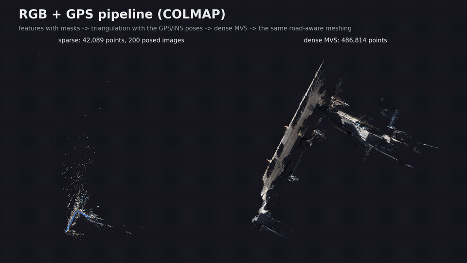
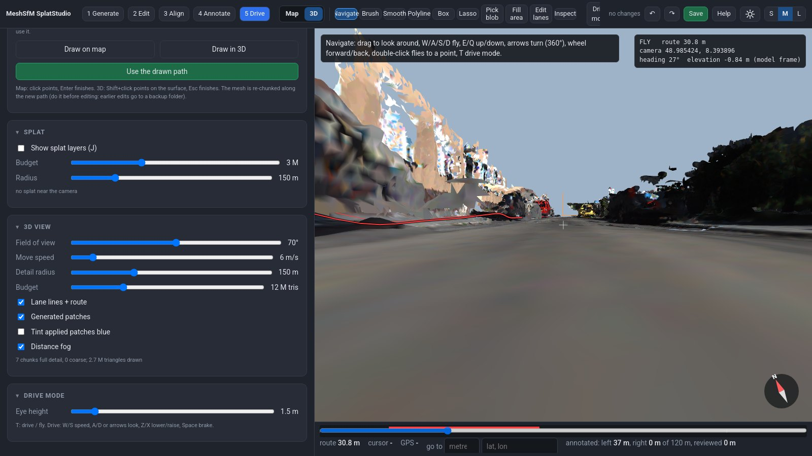
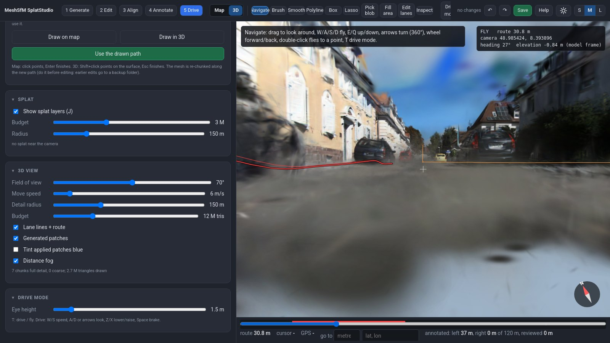
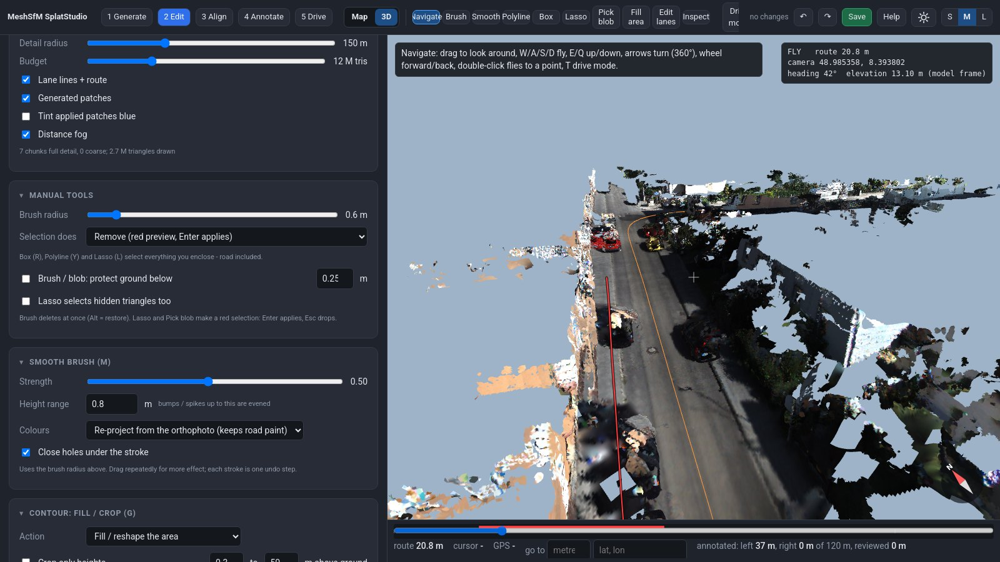
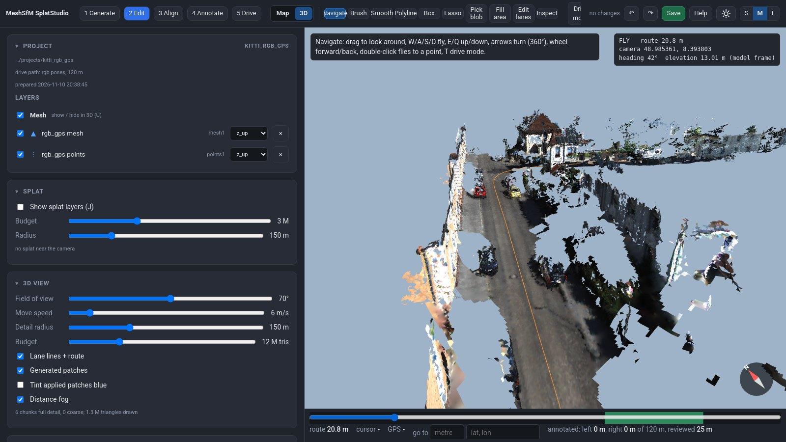
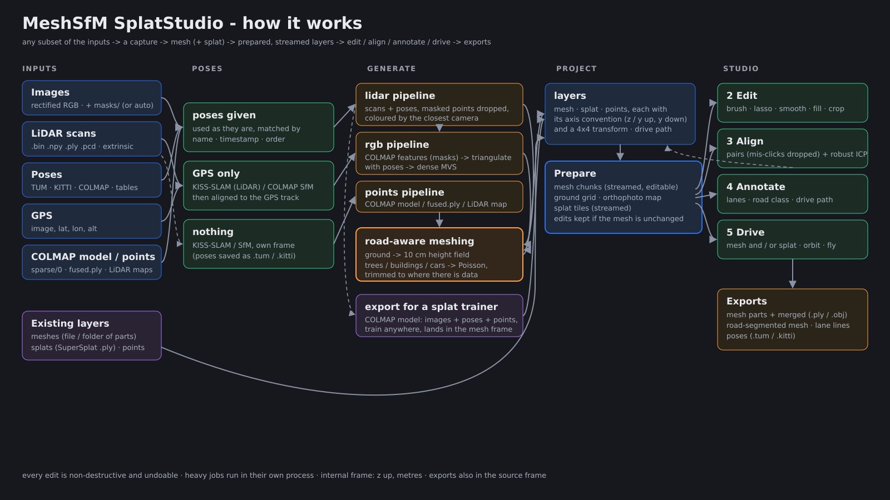
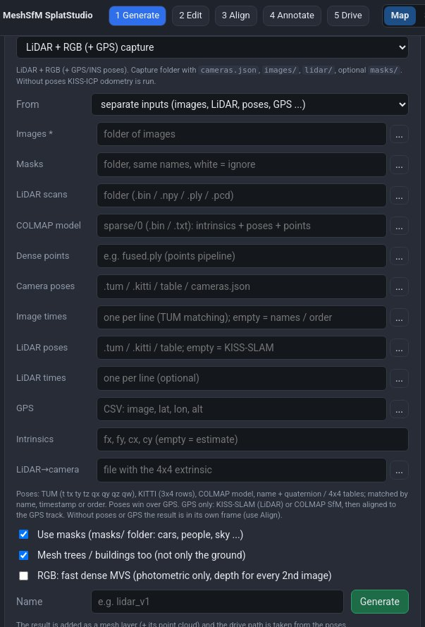
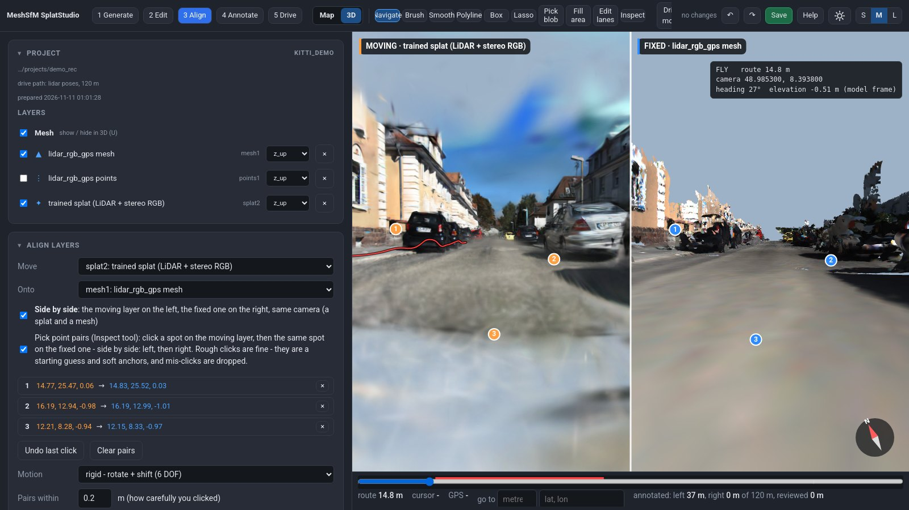

# MeshSfM SplatStudio

[](https://youtu.be/mAWjcFl-BhU)

A browser studio for road and street scenes. Generate a mesh from a **LiDAR + RGB (+ GPS)** or an **RGB (+ GPS)**
capture, clean and edit it, align it with **Gaussian splats** and point clouds, annotate lanes, and drive through mesh
and splat together. It runs locally (Python backend + WebGL2 page) and streams meshes of tens of millions of
triangles in chunks.

[](https://youtu.be/mAWjcFl-BhU)

| Drive: mesh (LiDAR + RGB + GPS) | Drive: Gaussian splat, same place |
|---|---|
|  |  |

| Same 120 m of KITTI: LiDAR + RGB + GPS (2.7 M triangles) | RGB + GPS only, COLMAP (1.3 M triangles) |
|---|---|
|  |  |

## How it works



## What it does

The studio is organised in five sections (top bar):

| Section | What you do there |
|---|---|
| **1 Generate** | Add layers (mesh file or folder of parts, splat `.ply`, point cloud) with their axis convention, generate a mesh from a capture or from separate inputs (images, LiDAR, poses, GPS, masks), export the capture for a splat trainer, **Prepare** (build what the studio streams). |
| **2 Edit** | Select with **Box (R)**, **Polyline (Y)** or **Lasso (L)** - everything you enclose, road included - and choose what the selection does: **remove · flatten · smooth · recolour**. Plus erase brush, pick blob, smoothing brush, contour **fill** and **crop**, automatic cleaning (floaters, ghost obstacles on the road, small islands, road levelling, off-road safety ground), re-project colours, **Inspect (I)** drops a map pin on the exact point (mesh or splat) with its GPS, undo / redo, **export**. Every edit is non-destructive and undoable. |
| **3 Align** | Align any layer to any other (splat ↔ mesh ↔ point cloud). Splat and mesh **side by side** (same camera) to click rough point pairs; mis-clicks are found and down-weighted; then a robust coarse-to-fine solve on the surfaces (+ colour). Rigid, keep-up-direction, + scale or shift only. Per-pair errors, before / after gap, certainty per axis; **Apply** changes only the layer's transform. |
| **4 Annotate** | Top-down orthophoto map (north up, right-drag rotates): lane edges, centre lines, dividers, stop lines (pen, free draw, split / join, parallel copy...). Lines are lifted onto the surface and exported (CSV / JSON / PLY). Road segmentation export (class Road inside the lane edges). Any line can become the **drive path**. |
| **5 Drive** | Drive along the path (or fly anywhere) with the mesh, the splat, or both - **U** toggles the mesh, **J** the splats. |

**Drive path**: comes from the poses of a generated capture, or the data's main axis - or simply draw it: *Drive path → Draw on map / Draw in 3D* (click points on the surface from any view, even eye level), then *Use the drawn path*.

**Mouse**: left-drag looks around (3D) / pans (map); **right-drag orbits around the point under the mouse (3D) / rotates the map**; wheel moves / zooms.

### Mesh generation

A *capture* is a plain folder (any dataset can be converted to it):

```
capture/
  images/          rectified RGB images
  masks/           optional, same names (.png, white = ignore): cars, people, sky ...
  cameras.json     intrinsics K, and per frame: image, T_world_cam, lidar, T_world_lidar, gps   (poses optional)
  lidar/           optional: scans (.bin x,y,z,i float32 / .npy / .ply / .pcd)
  georef.json      optional: lat0 / lon0 / alt0 of the local frame origin
```

| Pipeline | Input | How |
|---|---|---|
| `lidar` | LiDAR + RGB (+ GPS/INS) | scans accumulated with their poses (**KISS-SLAM** when there are none; KISS-ICP if kiss-slam is not installed); points landing in a mask are dropped as dynamic; colours from the camera that sees each point closest, occlusion-checked, masked pixels never used |
| `rgb` | RGB (+ GPS) | **COLMAP**: features (masks honoured), sequential matching, triangulation with the known poses (full SfM without poses), dense MVS (CUDA) |
| `points` | coloured point cloud | e.g. an existing COLMAP `fused.ply` or LiDAR map |



**No capture folder?** Give the inputs separately (Generate section → *From: separate inputs*, or the CLI flags):
images (required), masks, LiDAR scans, camera poses, LiDAR poses, GPS, intrinsics, LiDAR→camera extrinsic.

| You have | What happens |
|---|---|
| camera / LiDAR poses | used as they are: **TUM** (`t tx ty tz qx qy qz qw`), **KITTI** (3x4 rows, optional `times.txt`), a **COLMAP** model, `name tx ty tz qw qx qy qz` or `name` + 4x4 tables, `cameras.json`; matched to images / scans by name, by timestamp (nearest) or by order |
| a COLMAP model (+ images, + dense `fused.ply`) | intrinsics, camera poses and points from the model (`.bin` or `.txt`); the `points` pipeline meshes the dense cloud (or the sparse points) and the poses become the drive path |
| GPS only (`image, lat, lon, alt`) | LiDAR: **KISS-SLAM** (odometry + loop closures), then aligned to the GPS track; RGB: COLMAP SfM, then similarity-aligned to the GPS track (ENU metres) |
| LiDAR poses + LiDAR→camera extrinsic | camera poses derived from them (for colouring and masks) |
| no poses, no GPS | KISS-SLAM (LiDAR) / COLMAP SfM (RGB) in their own frame - estimated LiDAR poses are saved as `.tum` and `.kitti` in the capture; bring it into place in the Align section |

```bash
./meshsfm.sh gen PROJECT lidar --images imgs/ --lidar scans/ --gps gps.csv --T-cam-lidar extrinsic.txt --intrinsics "707,707,604,180" --masks masks/
```

### How the aligner works



Point pairs are a rough start and soft anchors, not the truth:

1. **Start**: heading + shift (+ scale) from the pairs, keeping up = up. Two pairs fix it, so three can already vote out a
   mis-click (RANSAC over all subsets), and pairs on a line cannot flip the layer over. With 4+ well spread pairs a full
   3D fit is tried as well, and the current placement always is.
2. **Pick the best start** after a short coarse pass: overlap with the fixed layer and agreement with the pairs.
3. **Robust Gauss-Newton, 0.5 m -> 3 cm voxels**: point-to-plane residuals (Geman-McClure weights, scale re-estimated each
   iteration) + a photometric term on the fixed layer's colour gradient (gain / offset fitted, so mesh vs splat exposure
   does not matter) + the pairs as Cauchy-weighted anchors - they hold the directions the geometry leaves free (a long
   straight flat road) and fade out when they disagree.
4. **Report**: residual of every pair (mis-clicks flagged), overlap / gap before and after, 1-sigma per axis, and the weakest
   direction with a hint where to add a pair.

On KITTI with a known offset (up to 8 m / 15° / 2.5° tilt, noisy clicks, careless pairs) it lands within 1 cm of the
reference.

### Gaussian splat from the same capture

*Generate → Export for a splat trainer* writes the capture as a COLMAP model - images, the capture's poses (GPS/INS,
KISS-SLAM or COLMAP) and the LiDAR / MVS points as the initial point cloud - for any 3DGS trainer. The trained splat is
in the capture frame, so it lines up with the mesh without alignment; add its `.ply` as a splat layer (z up).

```bash
python -m meshsfm.export_colmap CAPTURE gen/<name>/points.ply OUT          # images/ + sparse/0/
# train OUT with the 3DGS trainer of your choice, then:
./meshsfm.sh add PROJECT splat TRAINED.ply --frame z_up && ./meshsfm.sh prepare PROJECT
```

Training is left to you: any trainer that reads a COLMAP model works, as long as it does not re-centre or re-scale
the scene (otherwise the splat no longer sits on the mesh). For example with
[gsplat](https://github.com/nerfstudio-project/gsplat)'s `examples/simple_trainer.py`:

```bash
python examples/simple_trainer.py mcmc --data_dir OUT --data_factor 1 --result_dir OUT/gsplat \
    --no-normalize-world-space --save_ply            # -> OUT/gsplat/ply/point_cloud_29999.ply
```

For the KITTI demo, exporting both colour cameras (`meshsfm kitti ... --stereo`) gives a noticeably better splat.

## Install

Linux, Python ≥ 3.8, a WebGL2 browser. COLMAP with CUDA on `PATH` for the RGB pipeline; a 3DGS trainer of your choice for splats (not bundled).
Side panels fold away by clicking their titles; drag the panel edge to resize it; **S / M / L** (top right) sets the interface size; the sun / moon button switches light / dark mode.

```bash
git clone <this repo> MeshSfmSplatStudio && cd MeshSfmSplatStudio
./install.sh                      # .venv with numpy, scipy, open3d, opencv, kiss-icp, torch (auto-masks)
./meshsfm.sh ~/meshsfm/my_project # opens http://127.0.0.1:8780 (an empty project is created)
```

## Demo: KITTI, both pipelines

```bash
scripts/get_kitti_demo.sh ~/meshsfm_demo 0:200
./meshsfm.sh ~/meshsfm_demo/projects/kitti_lidar_rgb_gps     # LiDAR + RGB + GPS
./meshsfm.sh ~/meshsfm_demo/projects/kitti_rgb_gps           # RGB + GPS (COLMAP)
```

This downloads KITTI raw drive `2011_09_30_drive_0027` (4.4 GB), converts frames 0-200 (≈120 m) to a capture
with automatic masks for cars / people / bikes, and runs both pipelines. On one RTX 4090: LiDAR pipeline ≈ 4 min;
RGB pipeline ≈ 20 min (`--fast --ref-step 2`) or ≈ 75 min (full geometric MVS).

KITTI raw is © Karlsruhe Institute of Technology and Toyota Technological Institute, licensed CC BY-NC-SA 3.0
(non-commercial). It is downloaded by the script and not distributed here. Screenshots in this README show KITTI
data.

## Command line

```bash
./meshsfm.sh serve   PROJECT [--port 8780]
./meshsfm.sh add     PROJECT mesh|splat|points PATH [--frame z_up|y_up|y_down] [--name N]
./meshsfm.sh prepare PROJECT
./meshsfm.sh gen     PROJECT lidar|rgb|points CAPTURE [--no-masks] [--no-objects] [--fast --ref-step 2] [--name N]
./meshsfm.sh align   PROJECT MOVING_LAYER FIXED_LAYER [--max-dist 1.0] [--mode rigid|yaw|similarity|translation] [--apply]
./meshsfm.sh kitti   KITTI_DAY_DIR DRIVE CAPTURE_OUT [--frames 0:200] [--masks]
```

## Project folder

```
project.json   layers (source paths are referenced, never modified), per-layer 4x4 transform, settings, path
mesh/          streamed chunks, ground grid, drive path       tiles/   orthophoto + ground-surface points
edits/         masks, vertex edits, patches, undo history     splat/   streamed splat tiles
annotations/   lane lines + exports                           exports/ exported meshes
gen/           generation work files (point cloud, mesh, COLMAP workspace)
```

Internal frame: right-handed, **z up, metres**. Exports are written in this frame and, when the mesh came in another
axis convention, also in the source frame. Re-running *Prepare* keeps your mesh edits as long as the mesh inputs did
not change (otherwise the old edits are kept in a dated backup folder).

## Keys (3D)

`V` navigate · `B` erase brush (Alt restores) · `M` smooth brush · `L` lasso · `O` pick blob · `G` contour fill / crop
(on the map) · `I` inspect / align picks · `T` drive / fly · `W A S D Q E` fly · `Enter` apply · `Esc` drop ·
`Ctrl+Z / Ctrl+Y` undo / redo · **`U` mesh on / off · `J` splats on / off** · `H` all keys.

## License

Apache-2.0, see [LICENSE](LICENSE). Third-party components: [THIRD_PARTY.md](THIRD_PARTY.md).
